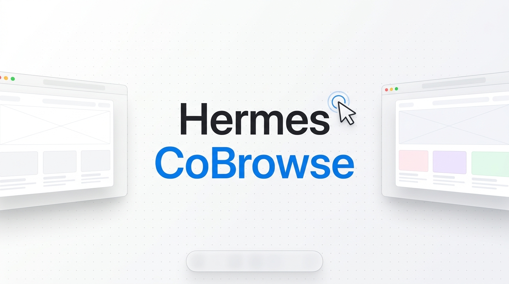
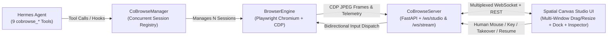
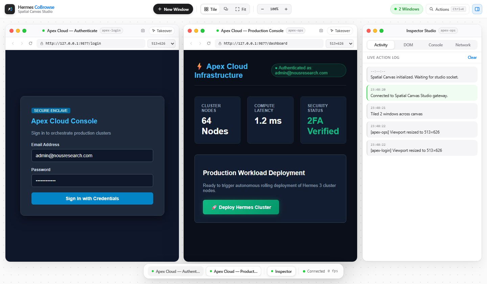
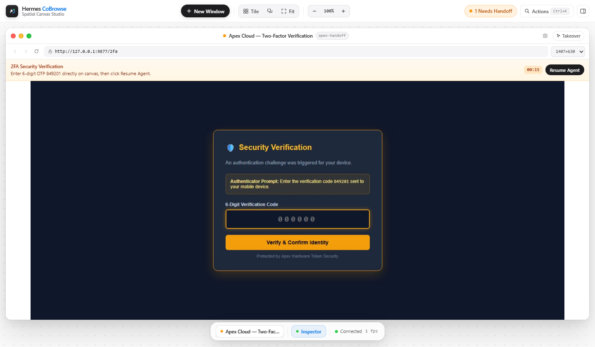
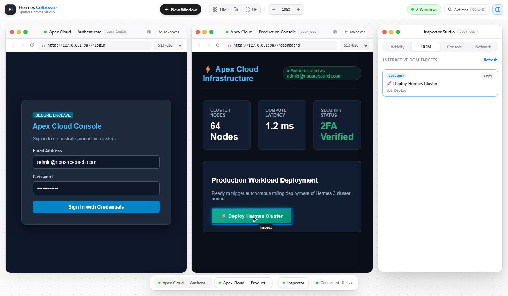

# Hermes CoBrowse

**Multi-Window Spatial Co-Browsing Canvas & Dual-Control Automation Studio for Hermes Agent**

[](plugin.yaml)
[](plugin.yaml)
[](hermes_cobrowse/engine.py)
[](pyproject.toml)

---

## Overview

Autonomous browser agents are fast until they hit workflows requiring human authentication, MFA/2FA verification, checkout approvals, or visual debugging across multiple parallel tabs. Standard headless scripts run invisibly in the background and fail silently when human intervention is needed.

**Hermes CoBrowse** bridges autonomous AI browsing and human control inside a **live minimalist white Spatial Canvas Studio** running on a separate localhost web view. Every headless Chromium browser session invoked by Hermes Agent (or launched directly from the studio toolbar) streams live via Chrome DevTools Protocol (`CDP`) as a **fully draggable, dynamically resizable floating window** alongside a real-time **Inspector Studio** and **floating Glass Dock**.

Everything shown in the canvas runs end-to-end against real Playwright Chromium instances, real CDP screencasts, real WebSocket frames, and real Chromium console and network events—with zero mocked data or simulated UI state.

---

## Features

### 1. Multi-Window Spatial Canvas
- **Concurrent Multi-Session Execution:** Run multiple isolated Chromium browser contexts side-by-side in one canvas—whether launched autonomously by Hermes Agent via `session_id` or spawned from the toolbar's **+ New Window** popover.
- **Full OS-Style Window Management:** Every browser window and the floating **Inspector Studio** support:
  - **Smooth Dragging:** Grab any window titlebar to position freely across the dot-grid spatial stage.
  - **8-Direction Dynamic Resizing:** Drag any edge (`N/S/E/W`) or corner (`NE/NW/SE/SW`) to dynamically resize windows; releasing automatically resizes headless Chromium's live viewport (`page.set_viewport_size` + CDP screencast retuning) so responsive pages reflow genuinely.
  - **Traffic-Light Window Actions:** Close individual browser sessions cleanly without disrupting sibling windows, **Minimize** to the frosted glass bottom Dock, or **Maximize (Full)** within the canvas stage and restore exact coordinates.
- **Instant Arrangement & Navigation:** One-click **Tile Grid**, **Cascade**, **Fit All**, and interactive background panning + zoom (`45%`–`150%`) plus `Ctrl+K` / `Cmd+K` **Quick Actions Palette**.

### 2. Dual-Control & Human Intervention Handoff
- **Autonomous Mode:** Watch Hermes Agent navigate, inspect interactive DOM nodes, type into inputs, and click targets with a live floating vector cursor (`Hermes`) and activity log.
- **Instant Manual Takeover:** Toggle **Takeover** on any individual window titlebar to stream pixel-accurate mouse clicks, cursor movement, scrolling, keyboard shortcuts, and clipboard paste directly into Chromium over WebSockets.
- **Structured 2FA / Approval Handoffs (`cobrowse_request_handoff`):** Hermes pauses execution on a specific session cleanly, displays a per-window amber intervention banner with guidance and live countdown timer, lets the user resolve 2FA or verification directly inside the streamed canvas, and immediately resumes agent execution when **Resume Agent** is clicked.

### 3. Real-Time Browser Chrome & Inspector Studio
- **Authentic Navigation Controls:** Per-window **Back**, **Forward**, and **Reload** history controls, live address bar (`Enter` to navigate), **Viewport Presets** (`1280×800` Desktop, `1440×900` Wide Desktop, `820×1024` Tablet, `390×844` Mobile), and **PNG Snapshot** download.
- **Inspector Studio (Floating Window):** Drag, resize, minimize, maximize, or toggle between four live telemetry tabs scoped to the focused window:
  - **Activity:** Live timestamped log of agent actions, page updates, viewport resizes, and handoffs.
  - **DOM:** Inspect visible interactive targets (`<button>`, `<input>`, `<a>`, etc.), copy generated CSS selectors (`CSS.escape` safe), or click any target card to scroll it into view and flash an active highlight ring directly inside the Chromium page.
  - **Console:** Real `console.log`, `warn`, and uncaught `pageerror` streams captured from Playwright.
  - **Network:** Real HTTP method, status code, resource type, latency (`ms`), and URL telemetry from Chromium responses and failed requests.

---

## Architecture



---

## Requirements

- **Python:** `3.10+` (`3.9+` compatible package declaration)
- **Hermes CLI:** `>=0.22.0` (when installed as a Hermes plugin)
- **Playwright Chromium:** Installed headless Chromium binary

---

## Quick Start

### Option A: Install as a Hermes Plugin (Recommended)

1. Install directly from GitHub using Hermes CLI, or clone into your local Hermes plugins directory:
   ```bash
   # Via Hermes CLI (GitHub URL or owner/repo shorthand)
   hermes plugins install https://github.com/sandman-sh/Hermes-CoBrowse.git
   # or: hermes plugins install sandman-sh/Hermes-CoBrowse

   # Or manual drop-in clone (Windows: %LOCALAPPDATA%\hermes\plugins\hermes-cobrowse)
   git clone https://github.com/sandman-sh/Hermes-CoBrowse.git ~/.hermes/plugins/hermes-cobrowse
   ```
2. Enable the plugin and install Playwright's headless Chromium runtime if not already present:
   ```bash
   hermes plugins enable hermes-cobrowse
   playwright install chromium
   ```
3. Validate manifest integrity, tool declarations, and runtime health:
   ```bash
   hermes plugins validate "path/to/Hermes-CoBrowse"
   hermes plugins doctor hermes-cobrowse
   ```

Once installed, all 9 `cobrowse_*` tools and the `post_tool_call` telemetry hook register automatically inside Hermes.

### Option B: Run Locally & Explore the End-to-End 2FA Demo

1. Clone and install dependencies:
   ```bash
   git clone https://github.com/sandman-sh/Hermes-CoBrowse.git
   cd Hermes-CoBrowse
   pip install -e .
   pip install pyyaml websocket-client httpx
   playwright install chromium
   ```
2. Launch the **Standalone Spatial Canvas Studio**:
   ```bash
   python -m hermes_cobrowse https://example.com
   ```
   Or launch the **Interactive Dual-Control 2FA Demo (`run_demo.py`)** which boots the local Apex Cloud portal (`/login`, `/2fa`, `/dashboard`), signs in autonomously, triggers a live human intervention handoff at the OTP checkpoint (`849201`), resumes upon completion, and executes deployment:
   ```bash
   python run_demo.py
   ```
3. Open your browser to `http://127.0.0.1:9876` (or the printed `preview_url`). Use **+ New Window** to spawn additional live Chromium windows on the same spatial canvas.

---

## Hermes Agent Tool Reference

All 9 tools support multi-window orchestration via the optional `session_id` parameter:

| Tool | Description | Key Parameters |
|---|---|---|
| `cobrowse_open` | Launches CoBrowse server and opens a browser window (or opens a parallel window). | `url`, `viewport_width`, `viewport_height`, `session_id`, `new_window`, `title` |
| `cobrowse_navigate` | Navigates a session to a URL and streams updated title, history state, and frames. | `url`, `session_id` |
| `cobrowse_get_state` | Extracts page URL, title, viewport dimensions, history availability, and interactive DOM elements with escaped CSS selectors. | `include_dom_tree`, `session_id` |
| `cobrowse_click` | Clicks via CSS selector, text locator, or `(x, y)` coordinates with animated cursor ripple telemetry. | `selector`, `x`, `y`, `button`, `session_id` |
| `cobrowse_type` | Focuses an input, clears if configured, types text cleanly, and optionally submits with Enter. | `text`, `selector`, `clear_first`, `press_enter`, `session_id` |
| `cobrowse_request_handoff` | Pauses autonomous execution cleanly for sensitive checkpoints (2FA, CAPTCHA, payments) until user completes action and clicks **Resume Agent**. | `reason`, `guidance`, `timeout_seconds`, `session_id` |
| `cobrowse_scroll` | Scrolls page (`up`, `down`, `top`, `bottom`). | `direction`, `amount`, `session_id` |
| `cobrowse_eval_js` | Evaluates custom JavaScript in the active session's browser page context. | `script`, `session_id` |
| `cobrowse_close` | Closes a specific window (`session_id`) leaving siblings running, or shuts down all windows and server when omitted. | `session_id` |

### Multi-Window Example Workflow
```jsonc
// Open two parallel tasks on the same Spatial Canvas
cobrowse_open({ "url": "https://portal.example.com", "session_id": "portal", "title": "Admin Portal" })
cobrowse_open({ "url": "https://docs.example.com", "session_id": "docs", "title": "API Docs", "viewport_width": 820, "viewport_height": 1024 })

// Act independently on each session
cobrowse_type({ "session_id": "portal", "selector": "#email", "text": "operator@example.com" })
cobrowse_scroll({ "session_id": "docs", "direction": "down", "amount": 600 })

// Close only the docs window when finished
cobrowse_close({ "session_id": "docs" })
```

---

## Spatial Canvas Gateway Endpoints

### WebSockets
- **`/ws/studio`** — Multiplexed Spatial Canvas hub receiving `studio_init`, multi-session `frame` packets tagged with `session_id`, lifecycle updates (`session_created`, `session_closed`, `session_focused`), `viewport_updated`, `page_updated`, `agent_action`, `intervention_required`, `intervention_resolved`, `console_log`, and `network_log`, while dispatching mouse, wheel, keyboard, focus, takeover, and resume actions by `session_id`.
- **`/ws/stream`** — Session-scoped stream WebSocket (`?session_id=...` optional) for single-viewport integrations.

### Studio REST API
- `GET /health` — Server health, active session ID, and session count.
- `GET /api/sessions` | `POST /api/sessions` | `DELETE /api/sessions/{session_id}` — List, spawn, or close live browser sessions.
- `POST /api/sessions/{session_id}/focus` — Focus session for Inspector Studio telemetry.
- `POST /api/sessions/{session_id}/navigate` | `back` | `forward` | `reload` — Control real Chromium navigation history.
- `POST /api/sessions/{session_id}/resize` — Resize Chromium viewport (`{ "width", "height" }`) and retune CDP screencast.
- `POST /api/sessions/{session_id}/resume` — Resolve an active human handoff pause.
- `POST /api/sessions/{session_id}/highlight` — Scroll CSS selector into view and flash visual bounding outline inside Chromium.
- `GET /api/sessions/{session_id}/state` | `telemetry` | `screenshot` — Retrieve interactive DOM tree, live Console & Network logs, or download PNG screenshot.

---

## Verification & Testing

Every layer of **Hermes CoBrowse** has real, unmocked automated tests covering Chromium CDP integration, tool handling, WebSocket dual-control, and multi-window Studio endpoints:

```bash
# Multi-window Studio E2E (concurrent sessions, Back/Forward, resize, console/network telemetry, highlight, PNG)
python tests/test_studio_multiwindow.py

# Headless Chromium BrowserEngine & CDP screencast unit/integration tests
python tests/test_engine.py

# Plugin manifest, 9 tool registrations, hooks, and Demo Portal tests
python tests/test_tools.py

# Full 2FA human intervention handoff & recovery E2E over live WebSockets
python tests/test_e2e.py
```

---

## Screenshots





---

## Security & Runtime Disclosures

In accordance with Hermes Plugin Catalog guidelines:

- **Authenticated Loopback Gateway (`127.0.0.1`):** Calling `cobrowse_open` starts a background FastAPI/Uvicorn WebSocket server bound strictly to loopback `127.0.0.1` (default port `9876`, auto-incremented if busy) protected by a per-run random auth token (`secrets.token_urlsafe`), strict `Host` allowlisting (`127.0.0.1`, `localhost`, `[::1]`), and exact WebSocket `Origin` verification so **only the tokened viewer** returned in `preview_url` can observe streams, call `/api/*` endpoints, dispatch inputs, or resume handoffs.
- **Minimal Browser Process Isolation:** Headless Chromium launches via Playwright with an explicit minimal `env=` (`PATH`, `HOME`, `LANG`, display vars only on POSIX; minimal OS/temp dirs on Windows) and never inherits host API keys or Hermes provider secrets.
- **SSRF & Scheme Guard (Off for Private Networks by Default):** Navigation and all redirect/sub-navigation hops enforce `http://` / `https://` scheme validation (`file://`, `chrome://`, `view-source:`, `data:`, and `javascript:` model inputs are refused) and block private, loopback, link-local (`169.254.169.254`), CGNAT (`100.64.0.0/10`), and IPv6 ULA/link-local addresses. Local dev targets require explicitly setting `allow_private_networks: true` in plugin settings (disabled by default).
- **DOM Password & OTP Redaction:** `cobrowse_get_state` redacts input values as `"[redacted]"` for `type="password"` and for `autocomplete` tokens `one-time-code`, `current-password`, and `new-password`.
- **Network Telemetry & Unattended Runs:** No external analytics, CDN assets, update checks, `.env` reads, or third-party scripts exist. `cobrowse_request_handoff` bounds waits (`1`–`900` seconds) and aborts immediately (`unattended_abort`) during Hermes cron (`current_cron_execution()`) or messaging gateway (`HERMES_SESSION_PLATFORM`) turns even if a viewer is connected.

---

## Project Layout

```text
Hermes-CoBrowse/
├── __init__.py                   # Root plugin entrypoint for Hermes discovery
├── plugin.yaml                   # Hermes plugin manifest & tool declarations
├── pyproject.toml                # Package build metadata
├── run_demo.py                   # Interactive dual-control + 2FA demo runner
├── assets/
│   └── banner.jpg                # Spatial Canvas Studio hero banner
├── docs/
│   └── screenshots/              # Verified live UI screenshots for docs & catalog
├── demo_portal/
│   └── app.py                    # Local Apex Cloud 2FA demo FastAPI application
├── plugin-catalog/
│   └── hermes-cobrowse.yaml      # Catalog submission metadata
├── hermes_cobrowse/
│   ├── __init__.py               # Tool registry & post_tool_call telemetry hook
│   ├── engine.py                 # Playwright + CDP lifecycle, input & telemetry capture
│   ├── schemas.py                # Tool JSON schemas (cobrowse_*)
│   ├── server.py                 # FastAPI Studio REST API + /ws/studio & /ws/stream
│   ├── tools.py                  # Thread-safe multi-session CoBrowseManager & handlers
│   └── web/
│       ├── index.html            # Spatial Canvas Studio UI markup
│       ├── style.css             # Minimalist white frosted glass theme
│       ├── app.js                # Multi-window drag, 8-way resize, Dock, Inspector & WS client
│       └── favicon.svg           # Minimal geometric SVG icon
└── tests/
    ├── test_studio_multiwindow.py
    ├── test_engine.py
    ├── test_tools.py
    └── test_e2e.py
```

---

## License

Released under the [MIT License](pyproject.toml).
